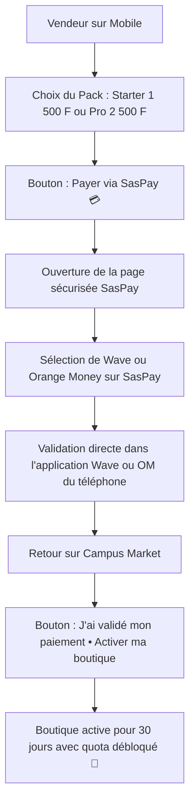

# Guide de Test Mobile, Paiement SasPay & Déploiement

Ce document résume tout ce qu'il faut savoir pour **continuer les tests sur votre smartphone**, utiliser les **liens de paiement SasPay (Wave / OM)** et **déployer/pusher** le projet Campus Market.

---

## 1. Comment Accéder et Tester depuis votre Smartphone (Même Réseau Wi-Fi)

Pour ouvrir et tester l'application directement sur votre téléphone portable :

### Étape 1 : Lancer le serveur Vite avec accès réseau
Ouvrez votre terminal et exécutez :
```bash
npm run dev -- --host
```

### Étape 2 : Récupérer l'adresse réseau affichée
Vite va afficher deux URLs dans votre terminal :
```text
  ➜  Local:   http://localhost:5173/
  ➜  Network: http://192.168.1.XX:5173/   <-- Adresse à copier
```

### Étape 3 : Ouvrir sur le navigateur de votre smartphone
1. Assurez-vous que votre téléphone est connecté au **même réseau Wi-Fi** que votre ordinateur.
2. Ouvrez **Chrome** ou **Safari** sur votre téléphone.
3. Entrez l'adresse `http://192.168.1.XX:5173/` (en remplaçant par l'IP affichée).
4. *Astuce PWA* : Sur Safari (iOS), cliquez sur le bouton Partager puis **"Sur l'écran d'accueil"** ; sur Chrome (Android), appuyez sur les 3 points puis **"Installer l'application"** pour avoir l'expérience native plein écran !

---

## 2. Les Formules & Quotas Vendeur

| Formule | Tarif | Quota d'Articles | Durée d'Accès | Lien SasPay |
| :--- | :--- | :--- | :--- | :--- |
| **Essai Gratuit** | **0 FCFA** | **3 articles** | **7 jours** | Aucun paiement requis |
| **Pack Starter** | **1 500 FCFA / mois** | **5 articles** | **30 jours** | [https://link.saspay.me/hgc4jifsarq](https://link.saspay.me/hgc4jifsarq) |
| **Pack Pro** | **2 500 FCFA / mois** | **10 articles** | **30 jours** | [https://link.saspay.me/gxky6adwejc](https://link.saspay.me/gxky6adwejc) |

---

## 3. Parcours de Paiement SasPay sur Smartphone

L'interface a été optimisée avec un **bouton unique de paiement** sans étape redondante :



---

## 4. Comment Remplacer le Lien SasPay du Pack Pro (2 500 F)

Dès que vous recevrez votre lien de paiement dédié de 2 500 F de la part de SasPay :

1. Ouvrez le fichier :
   [`src/config/subscription.js`](file:///home/mass/Documents/docs/projets/Campus-Market/src/config/subscription.js)
2. À la ligne 13, mettez à jour la constante `SASPAY_PAYMENT_LINKS` :
   ```javascript
   export const SASPAY_PAYMENT_LINKS = {
       starter: 'https://link.saspay.me/hgc4jifsarq',
       pro: 'https://link.saspay.me/VOTRE_NOUVEAU_LIEN_2500', // <-- Remplacez ici
   };
   ```
3. Mettez également à jour le fichier serverless API si déployé sur Vercel :
   [`api/create-subscription-checkout.js`](file:///home/mass/Documents/docs/projets/Campus-Market/api/create-subscription-checkout.js) à la ligne 19.

---

## 5. Commandes Git pour Sauvegarder et Pusher

Toutes les modifications sont prêtes. Pour les envoyer sur votre dépôt GitHub :

```bash
# 1. Vérifier les fichiers modifiés
git status

# 2. Ajouter tous les fichiers
git add .

# 3. Créer le commit
git commit -m "feat(subscription): packs 1500F/2500F, lien direct SasPay et interface simplifiée"

# 4. Envoyer sur GitHub (branche main)
git push origin main
```

---

## 6. Vérifications & Tests Automatisés

Si vous souhaitez relancer les vérifications à tout moment :

- **Tests SasPay & Quotas** :
  ```bash
  node tests/test-freetier-saspay.js
  ```
  *(49 assertions vérifiées à 100%)*

- **Tests Généraux de Non-Régression** :
  ```bash
  npm test
  ```

- **Build de Production Vite** :
  ```bash
  npm run build
  ```
