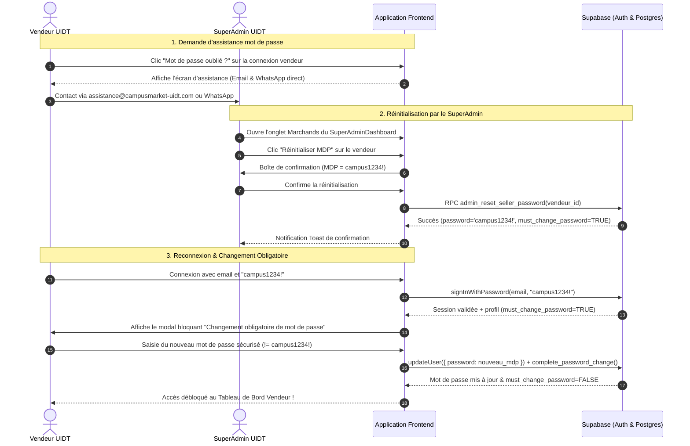

# Plan d'implémentation : Réinitialisation et Changement Obligatoire du Mot de Passe Vendeur

## Description du Projet
Actuellement sur **Campus Market (UIDT)** :
1. Les vendeurs n'ont pas de lien d'assistance clair sur le formulaire de connexion en cas d'oubli de mot de passe.
2. La politique de la plateforme requiert qu'un vendeur ayant perdu son mot de passe contacte le support officiel soit par **Email** (`assistance@campusmarket-uidt.com`), soit directement par **WhatsApp** (`+221 77 606 45 96`).
3. Le **Super Administrateur** doit pouvoir réinitialiser le mot de passe d'un vendeur en un clic dans son tableau de bord : le mot de passe doit alors devenir automatiquement `campus1234!`.
4. Dès que le vendeur se reconnecte avec ce mot de passe temporaire `campus1234!`, l'application doit lui **imposer obligatoirement** de définir un nouveau mot de passe sécurisé (différent de `campus1234!`) avant de pouvoir accéder à son Espace Vendeur.

---

## Validation et Retours Utilisateur Requis

> [!IMPORTANT]
> **Règles de sécurité et de flux :**
> 1. **Mot de passe temporaire par défaut :** `campus1234!` (défini automatiquement lors de la réinitialisation par l'admin).
> 2. **Changement obligatoire bloquant :** Dès la détection du mot de passe temporaire ou de l'indicateur `must_change_password`, un écran modal bloquant s'affiche. Le vendeur ne peut ni naviguer sur son tableau de bord ni ajouter/modifier de produits tant qu'il n'a pas défini un mot de passe d'au moins 6 caractères **strictement différent** de `campus1234!`.
> 3. **Canaux de contact d'assistance :**
>    - **Email :** `assistance@campusmarket-uidt.com` (avec objet et corps de message pré-remplis pour faciliter le traitement).
>    - **WhatsApp :** `+221 77 606 45 96` (avec message pré-rempli contenant les informations du compte).

---

## Architecture et Flux Utilisateur



---

## Modifications Proposées

### 1. Configuration du Support (`src/config/support.js`)
#### [MODIFY] `src/config/support.js`
- Ajout de l'adresse email officielle `assistance@campusmarket-uidt.com`.
- Ajout des liens préformatés `whatsappResetUrl` et `mailResetUrl` avec messages pré-remplis invitant l'étudiant à indiquer son nom, email institutionnel et boutique.

```javascript
export const SUPPORT_CONFIG = {
    phone: '+221 77 606 45 96',
    phoneDisplay: '+221 77 606 45 96',
    phoneRaw: '221776064596',
    email: 'assistance@campusmarket-uidt.com',
    phoneCallUrl: 'tel:+221776064596',
    whatsappUrl: 'https://wa.me/221776064596?text=' + encodeURIComponent("Bonjour ! Je contacte l'assistance et le support Campus Market UIDT."),
    whatsappResetUrl: 'https://wa.me/221776064596?text=' + encodeURIComponent("Bonjour ! J'ai oublié mon mot de passe pour mon compte vendeur Campus Market UIDT.\nMon adresse email est : "),
    mailResetUrl: 'mailto:assistance@campusmarket-uidt.com?subject=' + encodeURIComponent("Demande de réinitialisation de mot de passe vendeur - UIDT") + '&body=' + encodeURIComponent("Bonjour l'équipe support Campus Market,\n\nJe souhaite réinitialiser le mot de passe de mon compte vendeur.\n\nNom et Prénom :\nNom de ma boutique :\nAdresse email institutionnelle (@univ-thies.sn) :\nNuméro de téléphone :\n\nMerci d'avance pour votre aide."),
};
```

---

### 2. Formulaire de Connexion Vendeur (`src/components/seller/SellerAuthModal.js`)
#### [MODIFY] `src/components/seller/SellerAuthModal.js`
- Dans `renderLoginForm()`, sous le champ mot de passe, ajout d'un bouton discret et ergonomique :
  `<button type="button" id="btn-forgot-password" class="text-xs text-primary font-semibold hover:underline">Mot de passe oublié ?</button>`.
- Ajout du rendu `renderForgotPasswordScreen()` affichant clairement :
  - L'icône bouclier/clé et titre "Récupération de mot de passe".
  - L'explication de sécurité de l'UIDT.
  - Le bouton direct **Assistance WhatsApp** avec `SUPPORT_CONFIG.whatsappResetUrl`.
  - Le bouton direct **Assistance par Email** vers `assistance@campusmarket-uidt.com`.
  - Une notice explicative : "Votre mot de passe temporaire sera initialisé à `campus1234!`. Dès votre première connexion, il vous sera demandé d'en choisir un nouveau."
  - Le bouton "Retour à la connexion".
- Liaison des événements dans `bindEvents()`.

---

### 3. Schéma Base de Données & Procédure Stockée Supabase (`database/migration_reset_password_vendeur.sql`)
#### [NEW] `database/migration_reset_password_vendeur.sql`
- Ajout de la colonne `must_change_password` (BOOLEAN DEFAULT FALSE) dans `public.profiles`.
- Création de la fonction RPC `public.admin_reset_seller_password(target_user_id UUID)` :
  - Vérifie avec `public.is_super_admin(auth.uid())` que le demandeur est bien SuperAdmin.
  - Met à jour le mot de passe dans `auth.users` :
    `encrypted_password = extensions.crypt('campus1234!', extensions.gen_salt('bf', 10))`
  - Met à jour `public.profiles` : `must_change_password = TRUE`.
- Création de la fonction RPC `public.complete_password_change()` :
  - Vérifie que l'utilisateur est authentifié (`auth.uid() IS NOT NULL`).
  - Met à jour son profil : `must_change_password = FALSE`.

---

### 4. Service d'Administration (`src/services/admin-service.js`)
#### [MODIFY] `src/services/admin-service.js`
- Ajout de la méthode `adminResetSellerPassword(sellerId)` :
  - Tente d'appeler la fonction RPC `admin_reset_seller_password`.
  - Fallback vers l'API `/api/admin-reset-password` si la fonction RPC est indisponible.
  - Met à jour le profil avec `must_change_password = true` dans Supabase.
  - Export de la fonction dans l'objet par défaut et en export nommé.

---

### 5. Tableau de Bord SuperAdmin (`src/components/admin/SuperAdminDashboard.js`)
#### [MODIFY] `src/components/admin/SuperAdminDashboard.js`
- Dans la liste des marchands (`renderActiveSellersList`) :
  - Ajout d'un bouton d'action "Réinitialiser MDP" (icône `fa-key`) dans le tableau Desktop et la vue Mobile.
  - Si `s.must_change_password === true`, affichage d'un badge ambré "MDP réinitialisé (campus1234!)" pour que l'admin voie instantanément le statut.
- Dans `bindSellersEvents()` :
  - Écoute du clic sur `[data-action="reset-password"]`.
  - Affichage de `showConfirm` pour confirmation avec mention expresse du mot de passe `campus1234!`.
  - Appel de `adminResetSellerPassword(id)`.
  - Affichage du toast de confirmation et rafraîchissement immédiat de la vue.

---

### 6. Modal de Changement Obligatoire de Mot de Passe (`src/components/seller/ForcePasswordChangeModal.js`)
#### [NEW] `src/components/seller/ForcePasswordChangeModal.js`
- Composant modal bloquant (fermeture par backdrop ou touche Escape désactivée).
- Affichage clair de l'obligation de sécurité :
  - "Changement de mot de passe obligatoire"
  - "Votre compte a reçu un mot de passe temporaire suite à une réinitialisation. Pour garantir la sécurité de votre boutique, veuillez définir votre mot de passe personnel dès maintenant."
- Formulaire :
  - Nouveau mot de passe (avec bouton afficher/masquer le texte, indicateur de force visuel, min 6 caractères).
  - Confirmation du mot de passe.
  - Rejet formel si `nouveau_mot_de_passe === 'campus1234!'`.
- Bouton "Valider mon nouveau mot de passe" avec état de chargement.
- Bouton secondaire "Se déconnecter" pour permettre de quitter proprement sans modifier le mot de passe immédiatement.

---

### 7. Service Vendeur & Gestion de Session (`src/services/seller-service.js`)
#### [MODIFY] `src/services/seller-service.js`
- Mise à jour de `loginSeller({ email, password })` :
  - Détection automatique si `password === 'campus1234!'` ou si `profile.must_change_password === true`.
  - Retourne `mustChangePassword: true` dans le résultat.
- Ajout de la fonction `changeSellerPassword({ newPassword, confirmPassword })` :
  - Validation que le mot de passe fait au moins 6 caractères et n'est pas `campus1234!`.
  - Mise à jour dans Supabase Auth : `supabase.auth.updateUser({ password: newPassword })`.
  - Mise à jour du flag `must_change_password = false` via RPC ou mise à jour directe du profil.
  - Mise à jour du cache local du vendeur.

---

### 8. Intégration dans le flux Principal (`src/main.js`)
#### [MODIFY] `src/main.js`
- Instanciation du `ForcePasswordChangeModal`.
- Lors d'une connexion réussie dans `sellerAuthModalController` :
  - Si `mustChangePassword === true` ou `profile.must_change_password === true` :
    Ouvrir le modal `forcePasswordChangeModalController.open({ profile, onComplete: () => { ... } })`.
- Dans `openSellerFlow()` et `renderSellerView()` :
  - Si la session active possède `profile.must_change_password === true`, afficher immédiatement le modal bloquant et suspendre l'accès au tableau de bord.

---

### 9. Endpoint API Serverless Vercel (`api/admin-reset-password.js`)
#### [NEW] `api/admin-reset-password.js`
- Endpoint serveur `/api/admin-reset-password` recevant `{ sellerId }`.
- Si `SUPABASE_SERVICE_ROLE_KEY` est configurée, exécute `supabase.auth.admin.updateUserById(sellerId, { password: 'campus1234!' })` et marque le profil `must_change_password = true`.
- Assure une compatibilité totale avec les déploiements Vercel Serverless.

---

### 10. Tests Automatisés
#### [NEW] `tests/test-password-reset.js`
- Tests unitaires complets :
  1. Vérification des configurations de support (Email `assistance@campusmarket-uidt.com` et liens WhatsApp/Mailto).
  2. Vérification du rejet du mot de passe temporaire `campus1234!` comme nouveau mot de passe.
  3. Validation des critères de sécurité (longueur min 6 caractères, concordance des mots de passe).
  4. Vérification de la fonction `adminResetSellerPassword` et de la détection du statut `must_change_password`.
- Ajout de l'exécution dans `tests/sanity-check.js`.

---

## Plan de Vérification

### Tests Automatisés
```bash
# 1. Vérification unitaire de la suite de réinitialisation de mot de passe
node tests/test-password-reset.js

# 2. Exécution de la suite complète des tests de base
npm test
```

### Vérification Manuelle
1. **Écran de connexion vendeur :**
   - Cliquer sur "Espace Vendeur" -> "Se connecter".
   - Vérifier la présence du lien "Mot de passe oublié ?".
   - Cliquer dessus : vérifier l'ouverture de l'écran d'assistance, le lien WhatsApp avec message pré-rempli et le lien email vers `assistance@campusmarket-uidt.com`.
2. **Dashboard SuperAdmin :**
   - Se connecter en SuperAdmin (`/#admin`).
   - Aller sur l'onglet "Marchands".
   - Vérifier la présence du bouton "Réinitialiser MDP" sur un vendeur actif.
   - Cliquer sur le bouton : confirmer l'alerte modale mentionnant `campus1234!`.
   - Constater le message toast de succès et l'affichage du badge d'état.
3. **Reconnexion vendeur & Changement obligatoire :**
   - Se connecter avec l'email du vendeur et le mot de passe `campus1234!`.
   - Constater que le modal bloquant "Changement de mot de passe obligatoire" s'affiche immédiatement.
   - Tenter de saisir à nouveau `campus1234!` : constater le message d'erreur bloquant.
   - Saisir un nouveau mot de passe valide (ex: `MonNouveauMdp2026!`).
   - Constater la validation, la fermeture du modal et l'accès complet au tableau de bord vendeur.
